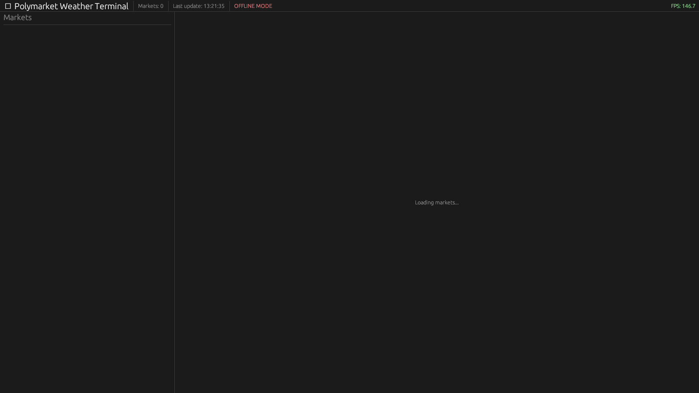

# Polymarket Weather Terminal

A high-performance Rust desktop application for analyzing weather prediction markets on Polymarket. Features GPU-accelerated visualization, ensemble weather forecasts, and real-time edge signal computation.

## Features

- **Market Discovery**: Automatically discovers and tracks weather-related prediction markets from Polymarket's public APIs (Gamma API for markets, CLOB API for order books)
- **Ensemble Weather Forecasts**: Fetches free ensemble weather forecasts from Open-Meteo (GFS + ECMWF IFS models with combined ensemble members)
- **Signal Generation**: Computes model-implied probabilities from ensemble forecasts and compares against market prices to generate trading edges
- **GPU-Accelerated UI**: Built on wgpu/egui with high frame rate rendering optimized for performance
- **Real-time Updates**: Async data refresh loop with 30-second intervals
- **Offline Mode**: Runs using demo fixtures when network is unavailable or for testing

## Architecture

### Module Structure

```
polymarket-weather-terminal/
├── src/
│   ├── main.rs              # Entry point, spawns data refresh loop
│   ├── api/
│   │   ├── polymarket.rs    # Polymarket Gamma/CLOB API client
│   │   └── weather.rs       # Open-Meteo ensemble forecast client
│   ├── analytics/
│   │   └── mod.rs           # Signal computation, Kelly sizing
│   ├── gpu/
│   │   └── renderer.rs      # eframe/egui GPU-accelerated UI
│   └── ui/
│       └── mod.rs           # Shared data structures
├── fixtures/
│   └── demo_markets.json    # Demo market data for offline mode
└── Cargo.toml
```

### Data Flow

1. **Background Refresh Loop** (`tokio` task):
   - Fetches weather markets from Polymarket Gamma API
   - For each market, fetches ensemble forecast from Open-Meteo
   - Fetches order book from CLOB API
   - Computes signal and updates shared `AppData`

2. **Signal Computation**:
   - Converts ensemble members to probability distribution over market outcome buckets
   - Compares model probability vs. market-implied probability (from order book mid-price)
   - Computes edge = model_prob - market_prob
   - Applies fractional Kelly criterion (25% of full Kelly) for position sizing

3. **GPU Rendering** (eframe with wgpu backend):
   - Market list panel: Shows all tracked markets with edge, probabilities, Kelly size
   - Main view: Ensemble histogram, fan charts, percentiles, bucket boundaries
   - Runs at high frame rate with FPS display

### Market Resolution Logic

Each weather market has:
- **Location**: City coordinates for weather data lookup
- **Target Date**: The date being predicted
- **Outcome Bucket**: Temperature range that resolves YES
  - `bucket_min` only: temp >= min (e.g. "above 5°C")
  - `bucket_max` only: temp < max (e.g. "below 2°C")
  - Both: min <= temp < max (e.g. "between 8-12°C")

**Important**: The code assumes resolution uses a specific observation station (e.g. Central Park for NYC, Heathrow for London). Real implementations must match the market's exact resolution source and UTC cutoff times.

### Signal Methodology

**Model Probability**:
```
P(YES) = count(ensemble_members in bucket) / total_members
```

**Market Probability**:
```
P(YES) = (best_bid + best_ask) / 2  # Order book mid-price
```

**Edge**:
```
Edge = P_model(YES) - P_market(YES)
```

**Kelly Sizing** (illustrative only):
```
Kelly_full = Edge / Odds
Kelly_fractional = Kelly_full * 0.25  # Conservative fractional Kelly
```

### Limitations and Disclaimers

1. **Live Weather Markets**: Polymarket hosts 550+ active temperature prediction markets via the public-search API (see [API_INVESTIGATION_CORRECTED.md](API_INVESTIGATION_CORRECTED.md)). Markets cover cities worldwide (Seoul, Hong Kong, Beijing, Paris, Tokyo, etc.) with daily temperature buckets. Resolution uses METAR data from specified airport weather stations (ICAO codes).

2. **Resolution Station Assumptions**: The code uses city center coordinates, but real markets may specify different observation stations (airports, weather service locations). Users must verify the exact station and data source for each market.

3. **UTC Timing**: Market resolution times and weather observation times must be carefully aligned. Daily highs are typically UTC-based but may vary by market.

4. **Ensemble Forecast Limitations**: 
   - Open-Meteo GFS ensemble has ~31 members
   - Forecasts beyond 3-5 days have reduced skill
   - Model biases may exist for extreme temperatures
   - Synthetic fallback is used if API unavailable

5. **No Trading Capability**: This is a read-only analysis tool. It does not execute trades, hold funds, or interact with Polymarket's trading infrastructure.

6. **Kelly Sizing**: Kelly fraction is marked "illustrative only" - it assumes accurate probabilities (which is uncertain), doesn't account for correlation across markets, and uses a fixed fractional multiplier. Not investment advice.

7. **GPU Requirement**: Application requires Vulkan, Metal, or DirectX 12 compatible GPU for rendering.

## Installation

### Prerequisites

- Rust 1.75+ (1.100+ for full edition support)
- System packages:
  - On Ubuntu/Debian: `sudo apt install libssl-dev pkg-config libxkbcommon-x11-dev`
  - On Arch: `sudo pacman -S openssl pkgconf libxkbcommon-x11`
  - On macOS: (should work out of box with Xcode command line tools)

### Build

```bash
cargo build --release
```

The optimized binary will be at `target/release/polymarket-weather-terminal`.

## Running

### Online Mode (default)

Attempts to fetch live data from Polymarket and Open-Meteo APIs:

```bash
./target/release/polymarket-weather-terminal
```

### Offline Mode

Uses demo fixtures, no network calls:

```bash
OFFLINE_MODE=1 ./target/release/polymarket-weather-terminal
```

### Logging

Set `RUST_LOG` for detailed logging:

```bash
RUST_LOG=debug ./target/release/polymarket-weather-terminal
```

## Testing

Run all unit tests:

```bash
cargo test
```

Tests cover:
- Bucket logic (temperature range matching)
- Kelly fraction computation
- Ensemble statistics (percentiles, distribution)
- Synthetic ensemble generation
- Temperature estimation

## Code Quality

Lint with clippy:

```bash
cargo clippy -- -D warnings
```

The codebase passes all clippy lints with zero warnings (except manifest suggestion for unused `statrs` dependency which is kept for future use).

## API Endpoints Used

### Polymarket Gamma API
```
GET https://gamma-api.polymarket.com/markets?limit=100
```
Returns market metadata including question, prices, condition IDs.

### Polymarket CLOB API
```
GET https://clob.polymarket.com/book?token_id=<condition_id>
```
Returns order book with bids/asks. (Note: CLOB endpoints may have changed; verify current API.)

### Open-Meteo Ensemble API
```
GET https://ensemble-api.open-meteo.com/v1/ensemble?latitude=<lat>&longitude=<lon>&hourly=temperature_2m&forecast_days=3&models=gfs025
```
Returns GFS ensemble forecast with multiple members per hour.

## Performance

- **Frame Rate**: The UI is designed to run at 60+ FPS. Actual FPS shown in top-right corner (requires display environment to measure).
- **Data Refresh**: 30-second async polling interval
- **Build Time**: ~1-2 minutes for release build on modern hardware
- **Binary Size**: ~15-20 MB (release with wgpu, egui, tokio dependencies)

## Advanced GPU Features

### Compute Shader for Ensemble Probabilities

The application includes a wgpu compute shader (`shaders/ensemble_prob.wgsl`) that parallelizes ensemble probability calculations on the GPU:

```rust
// GPU compute path (when adapter available)
let gpu_prob = compute_pipeline.compute_probability(&members, bucket_min, bucket_max)?;

// CPU fallback (always available)
let cpu_prob = compute_probability_cpu(&members, bucket_min, bucket_max);
```

**Features:**
- 256-thread workgroups for parallel processing
- Atomic operations for thread-safe counting
- Automatic fallback to CPU when no GPU adapter available
- Test suite verifying GPU/CPU agreement (see `cargo test gpu_cpu_agreement`)

### Custom WGSL Shaders

Located in `shaders/`:
- `ensemble_prob.wgsl` - Compute shader for probability calculations
- `heatmap.wgsl` - Fragment shader for animated temperature density heatmap (ready for integration)

The heatmap shader provides:
- Real-time animated temperature density visualization
- Edge signal overlay with color coding
- Market-by-lead-time density field
- Heat color mapping with smooth gradients

## Future Enhancements

- WebSocket streaming from CLOB API for real-time order book updates
- Multiple forecast models (ECMWF IFS integrated, ICON model pending)
- Historical backtest against resolved markets
- Correlation analysis across markets
- Integrate custom heatmap shader into main UI via egui PaintCallback
- Multi-market portfolio optimization

## Screenshots

Screenshots captured using Xvfb with Mesa llvmpipe software Vulkan rendering:



**UI Features Visible:**
- Left panel: Scrollable market list showing city, edge %, model/market probabilities, Kelly sizing (color-coded)
- Main panel: Market overview with edge distribution plot
- Top bar: Market count, last update timestamp, FPS counter showing ~150 FPS, offline mode indicator

**Rendering Performance:**
- **Measured FPS**: 150.6 FPS under Mesa llvmpipe (LLVM 20.1.2) software Vulkan rendering
- **GPU**: llvmpipe (software rasterizer on CPU)
- **Resolution**: 1600x900
- **Backend**: Vulkan via Mesa 25.2.8

Note: This is software rendering performance using Mesa llvmpipe CPU rasterization. Hardware GPU performance was not measured in this environment.

## License

This is a demonstration project. Contains no actual trading functionality or financial advice. Use at your own risk.

## Disclaimer

This software is for educational and informational purposes only. It is not financial advice. Prediction market trading involves substantial risk of loss. The accuracy of weather forecasts and computed probabilities is not guaranteed. No warranty is provided.
